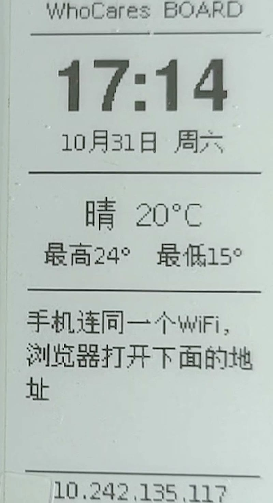

# WhoCares BOARD · 墨水屏桌面看板

一块 2.13 寸墨水屏，摆在桌上显示时间、宁波天气，手机浏览器打一句话几秒就能推到屏幕上。

**为什么做这个东西**：桌上的东西要么是买来的，要么是没用完的本子。想要一个「我自己写的、每天真会用」的东西——一个能随时把话推到眼前的小屏。它不连数据线、不装任何驱动，插个充电头就一直亮着。



## 功能

| 功能 | 说明 |
|---|---|
| 时间 / 日期 | 开机自动联网对时（NTP 阿里云），中文星期 |
| 天气 | 宁波实时天气 + 今日最高最低（open-meteo 免费接口，无需 API Key） |
| 手机发消息 | 板子自建网页，手机连同一个 WiFi 打开板子 IP，打字 → 约 3 秒上屏 |

- 每 5 分钟自动刷新一次时间与天气
- 收到消息立即刷新，不用等
- 断电或断网后自动重连

## 硬件

| 件 | 型号 | 价格 | 出处 |
|---|---|---|---|
| 主板+屏 | LilyGo T5 V2.3.2 / 2.13" 墨水屏（DEPG0213BN） | ¥136.49（含运费，套装含 T-U2T 下载器） | 淘宝实付订单，2026-10-25 |
| 下载器 | T-U2T（CH9102 芯片，Type-C） | 含在套装内 | 同上 |
| 供电 | 旧手机 5V 充电头 + Type-C 线 | ¥0 | — |

**总成本 ¥136.49。**

> 注意：这块板子上的 USB-C 口只供电，没有下载芯片。传代码必须用套装里的 T-U2T 下载器，从板子 USB 口插进去，再用 Type-C 线连电脑。

## 屏幕是什么芯片

- 面板驱动：**DEPG0213BN**（Good Display 出品，SSD1680 控制器）
- 分辨率：122 × 250，黑白
- 刷新：整屏约 2-3 秒。墨水屏刷新时整屏会闪一下（黑白反相），这是电子墨水的物理特性，不是故障

## 烧录

### 1. 环境

- Arduino IDE 2.3.10（官网下载）
- ESP32 开发板支持包 **3.3.10-cn**（国内镜像版，见下方说明）
- 库：`GxEPD2`、`Adafruit GFX Library`、`Adafruit BusIO`、`U8g2_for_Adafruit_GFX`

**国内装 ESP32 支持包必须用镜像**，否则从 GitHub 下载会失败。
在 `File → Preferences → Additional Board Manager URLs` 填：

```
https://jihulab.com/esp-mirror/espressif/arduino-esp32/-/raw/gh-pages/package_esp32_index_cn.json
```

然后在开发板管理器里选带 `-cn` 后缀的版本安装。

### 2. IDE 设置（这几项必须对）

| 项 | 值 |
|---|---|
| Board | ESP32 Dev Module |
| Port | 板子对应的 COM 口（设备管理器里看） |
| Partition Scheme | **Huge APP (3MB No OTA/1MB SPIFFS)** |
| PSRAM | Disabled |
| Flash Size | 4MB (32Mb) |
| Upload Speed | 921600 |

> 分区方案选错会出现「Sketch too big / 空间不足」。

### 3. 改两行配置

打开 `epaper_board/epaper_board.ino`，只改这两行：

```cpp
const char* WIFI_SSID = "你的WiFi名";   // 必须是 2.4G WiFi
const char* WIFI_PASS = "你的WiFi密码";
```

换城市改坐标（默认宁波）：

```cpp
const char* CITY_LAT = "29.87";
const char* CITY_LON = "121.55";
```

### 4. 上传

点上传（→）。这块板子带自动下载电路，不用按 BOOT 键。

## 用法

1. 插电，屏幕显示「开机中…→ 正在连WiFi」
2. 连上后屏幕底部显示板子的 IP，例如 `192.168.1.23`
3. 手机连**同一个 WiFi**，浏览器打开 `http://板子IP`
4. 输入框打字，点「发送到屏幕」，约 3 秒后屏幕更新

> 板子每次重启重连 WiFi，IP 可能会变，以屏幕底部显示的为准。

## 三个踩过的坑

**1. 板子连不上 WiFi，串口一直刷点**
不一定是密码错。先查手机热点设置里的「**最大连接设备数**」——小米/红米默认是 1 台，电脑占了名额，板子就挤不进去。改成 8 台即可。这个坑我排查了两小时，症状和密码错完全一样。

**2. IDE 显示旧代码**
IDE 打开的文件不会跟随磁盘变化。文件改了但 IDE 里还是旧内容时，上传烧的是**旧代码**。改完必须 `Ctrl+S`，或者关掉标签重新 `File → Open`。

**3. 天气高低温显示成 0° 或 1°**
解析 JSON 时手写字符偏移量容易错一位。本项目改用 `numAfter()` 函数自动跳过 `: [ "` 和空格，不再依赖数位置。

## 代码结构

```
epaper_board/epaper_board.ino
├── drawScreen()      画整屏（标题/时间/日期/天气/留言/IP）
├── fetchWeather()    请求 open-meteo 并解析（numAfter 取值）
├── wxText()          天气代码转中文（0=晴，3=阴，61=下雨…）
├── drawWrapped()     中文按宽度自动换行
├── htmlPage()        手机端网页
└── handleMsg()       接收消息 → 立即刷屏
```

中文字体用 `u8g2_font_wqy12_t_gb2312` / `wqy16`（文泉驿 GB2312 全集），英文数字也用它渲染，避免内置英文字体超宽换行。

## 后续想法

- [ ] 局部刷新：现在每 5 分钟整屏闪一次，改成只刷新时间区域
- [ ] 锂电池供电，做成真正无线的桌面摆件
- [ ] 待办清单同步（接 Notion 或自己的 API）
- [ ] 外壳：现在还是裸板

## License

MIT
